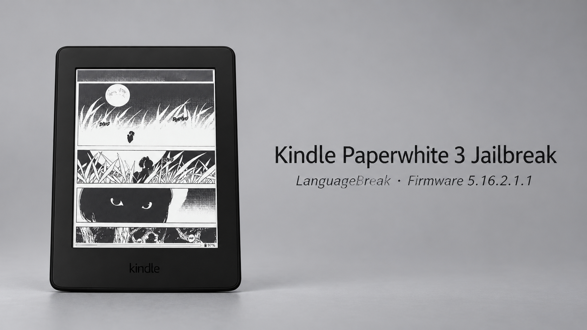
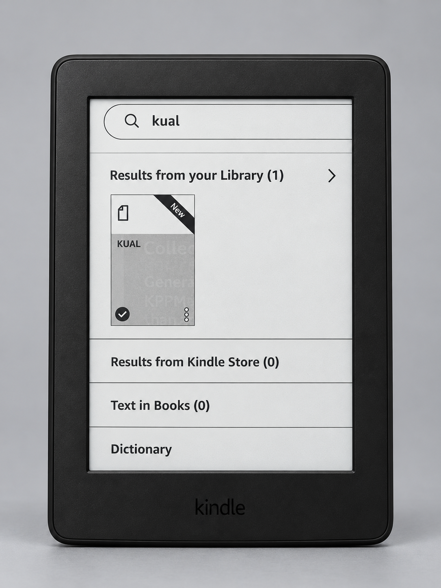
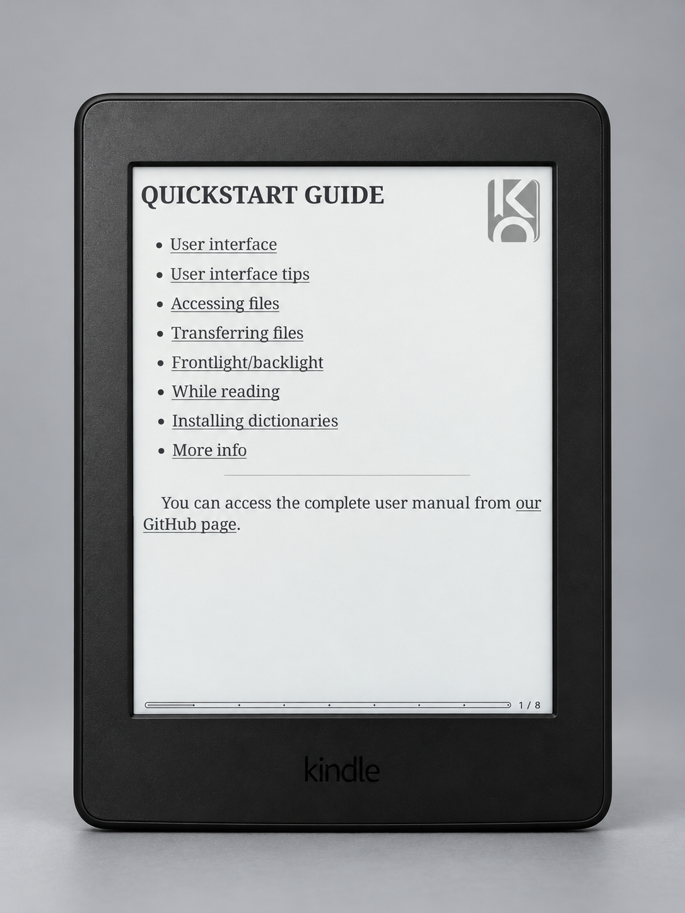

# Kindle Paperwhite 3 LanguageBreak: firmware 5.16.2.1.1



*User-supplied AI illustration; not a photograph of the tested Kindle or proof of a working installation.*

A first-hand record of one Kindle Paperwhite 3 (7th generation) LanguageBreak installation, plus cautious host-side transfer guidance. It is not a compatibility claim or a replacement for the upstream instructions.

> **Data loss:** LanguageBreak's upstream README warns that the method deletes all content on the device. Back up files you need before starting. This guide covers the files visible over USB; it does not create or verify a firmware image.

## Tested device and outcome

| Item | Evidence |
|---|---|
| Device | Kindle Paperwhite 3, 7th generation — firsthand session |
| Firmware before installation | 5.16.2.1.1 — firsthand session |
| Jailbreak log | `Added developer key`, `Finished installing jailbreak`, and `LanguageBreakRan` appeared — firsthand session |
| Hotfix | The `es-MX` hotfix succeeded after an earlier `Update Failed` — firsthand session |
| Other software | SimpleUI 2.7.5; KOReader v2026.07.1 (`kindlepw2`); LocalSend v1.4.5 (`armv7`) — firsthand session |

Only this device and firmware combination is documented as tested here. Version numbers identify the recorded session; they are not recommendations to download those versions today.

## Before you begin

1. Read the [LanguageBreak upstream README](https://github.com/notmarek/LanguageBreak/blob/master/README.MD) and its current release notes. The upstream instructions state a maximum supported firmware of 5.16.2.1.1 and warn that installation deletes device content.
2. Back up personal files visible in the Kindle's USB storage to a separate computer folder. Open a few copied files to confirm the backup is readable. This is a file backup, **not** a full-device or firmware image, and it cannot guarantee recovery of every Kindle setting or item.
3. Keep the backup and downloaded release payloads outside this repository. Do not run an unreviewed copy script against a device.
4. Follow upstream prerequisites, including its guidance on pending update files. Inspect and identify any such file yourself; never delete an unfamiliar file just because its name looks similar.

## Installation checkpoints from the firsthand session

The upstream README contains the complete procedure and should be followed for exact, current steps. The notes below describe observed checkpoints, not a standalone installation recipe:

- The LanguageBreak flow used Demo Mode and a time-sensitive second file transfer after the device displayed the power-button screen.
- In the first attempt, `jb` and `patchedUks.sqsh` ended up as zero-byte files. The roughly 20-second USB transfer window had been missed, and the hotfix reported `Update Failed`.
- A later attempt transferred the files in the required window; the jailbreak log showed the messages listed above.
- The locale-matched `es-MX` hotfix then completed successfully. Upstream advises retrying its hotfix step after an update-error screen; this does not establish that every failure has the same cause.


*Illustration generated with AI; not a photograph of the tested Kindle / not installation evidence.*

Do not treat a successful file copy as proof that firmware is supported or that the jailbreak completed. The USB host can compare bytes in files it copied, but it cannot verify Kindle firmware or interpret the device's internal state.

## USB transfer and safe removal

When the Kindle is in USB storage mode, the host sees a mounted filesystem for file transfer. That is not a firmware-verification mode. Before unplugging, use the desktop's safe-eject action or unmount the exact Kindle volume and wait for completion. If the Kindle is in KOReader, exit KOReader before reconnecting for USB mass storage; that was required in the recorded setup.

**Do not use the helper for either LanguageBreak payload transfer.** The upstream flow copies its payload twice and may require replacing files on the second, time-sensitive transfer. This helper intentionally refuses to overwrite existing paths and has no overwrite option. Follow the [upstream manual transfer steps](https://github.com/notmarek/LanguageBreak/blob/master/README.MD) for both copies.

For other explicit file transfers, the Linux helper in `scripts/kindle.sh` requires a block-device path and mount point that you have independently identified; `check` must pass before copying. For example, replace each placeholder with the correct paths:

```bash
bash scripts/kindle.sh check --device /dev/DEVICE_PARTITION --mountpoint /path/to/kindle-mount
bash scripts/kindle.sh copy --device /dev/DEVICE_PARTITION --mountpoint /path/to/kindle-mount --source /path/to/extracted-payload
bash scripts/kindle.sh verify --device /dev/DEVICE_PARTITION --mountpoint /path/to/kindle-mount --source /path/to/extracted-payload
bash scripts/kindle.sh eject --device /dev/DEVICE_PARTITION --mountpoint /path/to/kindle-mount
```

The helper does not search for a disk, mount it, remove files, install payloads, or configure autostart. It refuses to overwrite existing destination paths. If a later file fails to copy, earlier verified files may remain; inspect the device before retrying. `eject` asks UDisks to unmount and power off the explicitly selected block device. UDisks notes that powering off a physical device with multiple drives can affect the other drives too; do not use this helper for shared multi-drive hardware. The helper has only been tested offline with mocks, not against Kindle hardware. A helper-side byte comparison means only that selected source and destination files matched during the check; it cannot verify firmware or installation state. See the [UDisks command reference](https://storaged.org/udisks/docs/udisksctl.1.html) for safe-removal behavior and limitations.

## Post-install software notes

- **KUAL:** The PEKI (`KUAL.sh`) entry did not appear in the library. KUAL then worked after opening MRPI with `;log mrpi` and running its booklet. A `kppmainappv2` core dump was also recorded; it did not prevent KUAL from working.

  

  *Illustration generated with AI; not a photograph of the tested Kindle / not installation evidence.*

- **KOReader:** Version v2026.07.1 (`kindlepw2`) ran in the recorded session. LocalSend v1.4.5 (`armv7`) was also installed; `Project: Title` was removed after it conflicted with SimpleUI.

  

  *Illustration generated with AI; not a photograph of the tested Kindle / not installation evidence.*

- KOReader autostart was deliberately declined and is not installed by this guide or helper.

## Troubleshooting

See [TROUBLESHOOTING.md](TROUBLESHOOTING.md) for the observed copy-window failure, update-error handling, USB transfer checks, and scope limits.

## Source and attribution

The upstream LanguageBreak project owns its installation procedure and release files: [notmarek/LanguageBreak README](https://github.com/notmarek/LanguageBreak/blob/master/README.MD). This guide summarizes only the portions needed to frame the firsthand notes; consult upstream before acting because its instructions and releases may change.

Device-specific results in this guide are labeled as firsthand observations from one session. All other compatibility and procedure claims are either attributed to upstream or explicitly left unverified.
